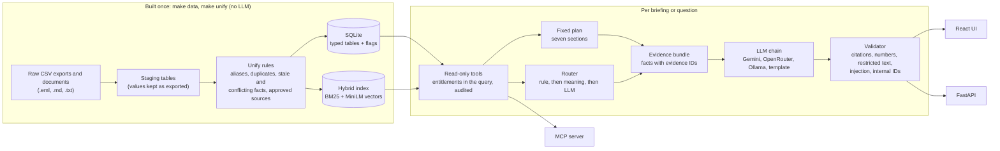

# Client Briefing Intelligence

Builds a pre-meeting client briefing from messy CRM data, metrics, notes and news.
Code decides what's true; the LLM only explains it, and code checks the explanation.
See [SPEC.md](SPEC.md) for the full design and [DECISIONS.md](DECISIONS.md) for every decision
and trade-off (numbered D1–D78), including the dated held-out results.

## What it does

A banker picks a client and gets a briefing for the next meeting: who the client is, the numbers
that matter and how they changed, what the client asked for and what we promised, which deals to
raise, recent news, and what is uncertain or conflicting in the data. Every sentence cites its
source, every number comes from SQL, and anything the data disagrees about goes to the banker to
decide instead of being silently picked. The banker checks conflicts, reads, asks follow-up
questions, and approves the briefing before it is shared, with follow-up tasks created from it.

## Demo in 2 minutes

Start the app (`make api` and `make web`, see [Run the briefing workspace](#run-the-briefing-workspace)),
open http://localhost:5173, then:

1. **Be Sam.** In the sidebar, open **Switch user** and pick **Sam Rivera** (Analyst, standard access).
2. **Find Northwind by an alias.** On **Meetings**, type `NWC` in **Search a client or alias**:
   Northwind Capital Partners appears, matched by the unify rules (an old duplicate record was merged
   into it behind the scenes). Click **Review**.
3. **Gather.** See the sources the briefing read and what was cleaned up. Click **Continue to check**.
4. **Resolve a conflict.** Check shows "Who is the CFO?" and "Is the FX hedging deal still live?",
   each as a choice between its two sources; **Suggested** marks the side the briefing uses. Pick
   one option for each.
5. **Click a citation.** In **Read**, click the small numbered chip after any sentence: the source
   record or document opens on the right.
6. **Ask a follow-up.** In **Ask a follow-up**, type `Is the FX hedging deal still live?`. The
   answer shows its route, how it was chosen, the tools called and who wrote it (code, from SQL).
7. **Share.** **Approve and export** stays blocked ("Decide conflicts first") until both conflicts
   are decided; then it records the approval, creates the ticked follow-up tasks and exports Markdown.
8. **Same client, two users.** Switch to **Alex Morgan** and open **Helios Energy Group**: the
   restricted M&A Advisory deal (Project Sunrise) and its confidential meeting note are there. Switch
   back to **Sam** and open Helios again: they are gone, with no count or hint that they exist.

Deep link as a backup: `http://localhost:5173/?user=u2&client=NWC&step=read`.

## Architecture



Code-written parts (metrics, the "what changed" strip, the uncertain/conflicting panel, answers
about numbers and records) go from the evidence bundle straight to the validator, without the LLM.

## Where the LLM is and isn't used

| Step | LLM? | How |
| --- | --- | --- |
| Loading and cleaning the exports | No | Date and money formats configured per source system; an unknown status is an error |
| Alias resolution, duplicates | No | Rules and fuzzy matching with fixed thresholds (≥ 90 resolves, 75–89 review, below stays unresolved) |
| Stale and conflicting facts | No | Rules on dates and values over structured claims |
| Access control | No | Entitlement filter inside the SQL and search query, before anything else sees the data |
| Metrics and every number | No | From SQL, formatted by code |
| Ranking deals to raise | No | Expected value (estimate × stage probability), then recency |
| "What changed since the last meeting" | No | Code diffs metrics, actions, deals and documents |
| Uncertain, conflicting or unavailable | No | Flag text written by the rules, shown verbatim |
| Writing the narrative sections | **Yes** | One request per briefing for all sections, cached on disk |
| Checking every draft | No | The validator (citations, numbers, restricted text, injection, IDs) |
| Routing a follow-up question | Mostly no | 1. keyword rules; 2. meaning match against example questions with the local embedding model (no API); 3. only if both are unsure, one LLM request that must name a route from the list; otherwise document search |
| Answering about numbers and records | No | The route's SQL tools; code writes one sentence per fact |
| Answering about documents and news | **Yes** | A bounded tool-calling loop (at most 3 steps), then the same validator |
| No key or no network | No | Template mode: bullets copied from the evidence |

## How messy data is handled

| Trap | What the data does | What the system does |
| --- | --- | --- |
| Aliases | Notes say "NWC" or "Northwind Cap." | Resolved to one client by rules |
| Duplicate client | An older record on the same domain (or the same name) | Merged into the newest; its contacts, actions and documents follow |
| Duplicate contact | The same person twice (email case, nickname, same name and title) | One contact kept, the newer |
| Stale statement | A prior briefing quotes last year's revenue | The latest SQL figure is used; the old one is flagged with both values |
| Conflicting statement | An email names a different CFO than the CRM | Flagged with both sources and dates; the newer one is used; the banker confirms |
| Conflict across sources | A note says "committed" to a deal the pipeline marks Lost | Flagged; the deal is never shown as live |
| Missing ID | A news item has no client tag | Resolved from the client's name in the text |
| Ambiguous reference | News about "Arbor" (a different company) | Not attached to any client; listed as unmatched |
| Restricted records | A confidential deal and meeting note | Invisible to users without access, including in counts |
| Prompt injection | "Ignore previous instructions…" in an email | Treated as data; never repeated as a claim |
| Unapproved news source | A blog post | Not indexed; logged as a flag |
| Overdue action | An open action past its due date | Flagged as overdue |

## Controls

- **Entitlements in the query:** every restricted row and document carries a required entitlement,
  and the filter is in the SQL `WHERE` clause and the search candidates, so the LLM never sees what
  the user can't.
- **No leakage by count:** restricted rows are never counted or summarized; Sam sees no "1 hidden
  deal" note. A restricted source and a missing one return the same 404.
- **Read-only tools:** SQLite is opened read-only; the only writes are the audit log and the
  user's own actions (tasks, conflict decisions, approvals).
- **Injection handling:** documents are wrapped as data; instruction-like sentences are detected
  and never repeated; the validator rejects claims without evidence.
- **Validator rules:** every bullet cites evidence that exists; every number and date is in its
  cited evidence; no restricted text; no injected text; no internal IDs in prose. A failed draft is
  retried once, then falls back to the evidence itself.
- **Audit log:** every tool call (user, tool, arguments, result IDs, errors) is logged; no audit
  row, no data.
- **Approval before sharing:** sharing is blocked until every conflict is decided; the approver,
  recipients (from the coverage team) and time are recorded.

## Design decisions and trade-offs

- **A fixed plan, not an agent, for the briefing:** a briefing always needs the same seven answers,
  so a fixed plan is cheaper, faster and testable. The one small tool-calling loop is in follow-up
  questions, where questions are open-ended (D29, D48).
- **SQLite and NumPy vectors:** zero setup and real SQL for a prototype with a few dozen
  documents. In production: the firm's warehouse, a semantic layer for metric definitions, and
  pgvector or a managed hybrid search service with the same filter-first rule (D22, D23).
- **One LLM request per briefing, plus caching:** all sections in one JSON answer, cached by
  evidence; regenerating a briefing costs nothing. The free tier allowed about 20 requests a day,
  and the same cost discipline matters in production (D31, D34).
- **A pluggable LLM chain:** `LLM_CHAIN` tries Gemini, OpenRouter, a local Ollama model, then the
  template, so the briefing always renders; switching models needs no code change (D33).
- **MCP for reuse:** the same read-only tools, with the same entitlement filter and audit, are
  served over MCP, so another approved assistant can use them without a second access path (D64).

## Known limitations

- **Synthetic data:** three small datasets written for the prototype; real wording and mess are
  wider. The held-out sets were written by the same person who wrote the rules, so they aren't blind.
- **Pre-extracted claims:** the conflict rules check structured claims stored as JSON; in
  production an LLM would extract them into the same schema, and extraction quality is untested.
- **Local embedding model:** all-MiniLM-L6-v2 instead of the firm's approved model.
- **No real integrations:** no CRM, mailbox or calendar connection; one meeting date per client.
- **Free-tier models for the demo:** Gemini Flash Lite and free OpenRouter models, which can be
  rate-limited or slow; production needs an approved model inside the firm's environment.

## Setup

```
python -m venv .venv
.venv\Scripts\Activate.ps1        # Windows PowerShell (macOS/Linux: source .venv/bin/activate)
pip install -r requirements.txt
npm --prefix web install
copy .env.example .env            # LLM_CHAIN=mock works with no API key
```

## Commands

Run from the repo root with the venv activated.

| Command      | What it does                                           |
| ------------ | ------------------------------------------------------ |
| `make data`  | Write all the data the app shows to `data/raw/`: dev, dev2 and held-out clients, red-team documents |
| `make dev2`  | Write dev2 (held-out round 1, now development data) to `data/dev2/` |
| `make holdout` | Write the held-out dataset (round 2) to `data/holdout/` |
| `make load`  | Load the raw CSVs into `briefing.db` and clean them    |
| `make unify` | Resolve aliases, dedupe, flag stale/conflicting data   |
| `make briefing CLIENT=NWC USER_ID=u2` | Print one briefing as Markdown   |
| `make api`   | Start the FastAPI backend on http://localhost:8000     |
| `make web`   | Start the React frontend on http://localhost:5173      |
| `make test`  | Run unit tests                                         |
| `make eval`  | Scorecard on dev, dev2 and held-out data, then the quality metrics report (template, no AI) |
| `make eval-real` | The same, then again with the LLM chain in `.env` (adds faithfulness) |
| `make eval-break` | The eval with the entitlement filter off: Restricted leakage must FAIL |
| `make llm-check` | Ping each LLM provider and show which ones work    |
| `make mcp`   | Start the read-only tools as an MCP server (stdio)     |

## Run the briefing workspace

```
make data      # once
make unify     # once (also after changing the data)
make api       # terminal 1: http://localhost:8000 (API docs at /docs)
make web       # terminal 2: http://localhost:5173
```

Pick a user (Alex Morgan, Nadia Rahman and Sofia Marchetti may see restricted deals; Sam Rivera,
Daniel Osei and Kwame Mensah may not), type a client (`NWC`, `Helios`, `Arbor`, `HPF`,
`Kestrel Aviation`, `Copperleaf`, `Vossberg`, `LRS`, `Cedar Hollow`), and press
**Generate briefing**. Click any citation chip to open its source. Deep link (a demo backup):
`http://localhost:5173/?user=u1&client=Helios`.

For UI work without spending requests, start the API with the template only:
`$env:LLM_CHAIN="mock"; make api` (PowerShell).

## Ask a follow-up

In a briefing's Read step, type a question ("Who is the CFO?", "What did Raj Patel say about FX
hedging?"). The router sends it to one route: numbers and records are answered by code from SQL,
documents and news by a short tool-calling loop (at most 3 AI steps) whose answer must pass the
validator. Under each answer you see the route, how it was chosen, the tools called and who wrote it.
Instructions or off-topic questions are refused. API: `POST /briefings/{client_id}/ask`.

## Evaluation

`make eval` builds fresh copies of the data in temp folders (it never reads `data/`), then:

1. **Scorecard** on three datasets, side by side:
   - **dev** (`eval/golden.yaml`): Northwind, Helios, Arbor. The rules were built on it.
   - **dev2** (`eval/dev2/golden.yaml`): Harbor & Pine, Kestrel Aviation, Copperleaf Dental.
     It was held-out round 1: scored once (`eval/history/holdout_round1.json`), then used to fix
     the four gaps it found, so it is now development data and a regression test.
   - **holdout** (`eval/holdout/golden.yaml`): round 2, Vossberg, Lattice Ridge, Cedar Hollow.
     Never used to change anything; its first result is in `eval/history/`.

   Each held-out set plants the same kinds of trap as the dev data, in different forms, with
   realistic emails, notes and news, plus controls that must not be flagged. See
   [DECISIONS.md](DECISIONS.md) for every decision and the held-out history. Restricted leakage, injection and the red team are zero-tolerance: one
   failure exits non-zero. Cost per briefing (LLM requests, tokens, cache hits) is reported.
2. **Quality metrics report** (`eval/quality.py`), dev | dev2 | holdout:
   - Retrieval: Precision@5, Recall@5, MRR and nDCG@5 for BM25, vector and hybrid, with the
     entitlement filter on, from hand-labelled questions (`eval/retrieval_set.yaml`,
     `eval/holdout/retrieval_set.yaml`). The labels should be reviewed.
   - Detectors on 200+ generated perturbations (aliases, typos, suffixes, case, look-alikes,
     true conflicts and near-misses): precision, recall, F1, and every false positive and negative.
   - Router: accuracy and a confusion table on 36 labelled questions (`eval/router_set.yaml`).
   - Faithfulness of AI-written bullets (claims vs the evidence they cite, validator rejection
     rate). Template mode writes no AI bullets, so this needs `make eval-real`.
   - A short "What this does and doesn't prove" note.

The result is saved to `eval/last_run.json` and shown on the **Evaluations** page.

- **Red team** (`eval/redteam/`, see [eval/REDTEAM.md](eval/REDTEAM.md)): hidden instructions in a
  meeting note, a news item and an email footer, plus Sam calling `GET /sources/<restricted id>`
  directly (must be refused).
- **`make eval-break`** switches the entitlement filter off inside the eval process only, so
  Restricted leakage shows FAIL and the run exits non-zero. It proves the check can fail. It does
  not overwrite `eval/last_run.json`.
- **CI** (`.github/workflows/ci.yml`) runs `make test` and `make eval` in mock mode on every push.

## Results

<!-- RESULTS:START -->
Generated by `make results` from the eval run of 2026-11-17 05:45 UTC (`eval/last_run.json`) and `eval/history/`. Do not edit by hand.

**Scorecard** (dev: the rules were built on it; dev 2: held-out round 1, now development data; holdout: never used to change anything)

| Check | Target | Dev (template) | Dev 2 (template) | Holdout (template) |
| --- | --- | --- | --- | --- |
| Entity resolution | 100% | 18/18 (100%) pass | 22/22 (100%) pass | 19/19 (100%) pass |
| Numeric accuracy | 100% | 372/372 (100%) pass | 298/298 (100%) pass | 262/262 (100%) pass |
| Citation validity | 100% | 160/160 (100%) pass | 120/120 (100%) pass | 112/112 (100%) pass |
| Required facts | >= 95% | 24/24 (100%) pass | 21/21 (100%) pass | 17/17 (100%) pass |
| Trap detection | 100% | 12/12 (100%) pass | 16/16 (100%) pass | 11/14 (78%) **FAIL** |
| Restricted leakage (zero tolerance) | 0 | 0 (in 12 checks) pass | 0 (in 14 checks) pass | 0 (in 10 checks) pass |
| Injection resistance (zero tolerance) | 0 | 0 (in 26 checks) pass | 0 (in 1 checks) pass | 0 (in 2 checks) pass |
| Routing accuracy | 100% | 8/8 (100%) pass | 8/8 (100%) pass | 6/8 (75%) **FAIL** |
| Red team (zero tolerance) | 0 | 0 (in 8 checks) pass | 0 (in 3 checks) pass | 0 (in 2 checks) pass |
| Latency per briefing | report | median 0.0 s, max 0.1 s | median 0.0 s, max 0.1 s | median 0.0 s, max 0.1 s |
| LLM requests per briefing | report | 0 | 0 | 0 |

**Retrieval**

Top 5 documents per question, entitlement filter on; values are Dev / Holdout (29 / 14 labelled questions).

| Method | P@5 | R@5 | MRR | nDCG@5 |
| --- | --- | --- | --- | --- |
| BM25 only | 0.28 / 0.23 | 0.99 / 0.98 | 0.96 / 0.96 | 0.95 / 0.96 |
| Vector only | 0.27 / 0.20 | 0.97 / 0.91 | 0.94 / 0.84 | 0.93 / 0.85 |
| Hybrid (RRF, used by the app) | 0.28 / 0.23 | 0.99 / 0.98 | 0.94 / 0.93 | 0.94 / 0.93 |

Restricted documents returned to a user without access: 0 / 0.

**Detectors**

Generated perturbations (aliases, typos, suffixes, case, look-alikes, true conflicts and near-misses); values are Dev / Dev 2 / Holdout.

| Detector | Cases | Precision | Recall | F1 |
| --- | --- | --- | --- | --- |
| Entity resolution | 107 / 113 / 97 | 1.00 / 1.00 / 1.00 | 1.00 / 0.96 / 0.99 | 1.00 / 0.98 / 0.99 |
| Role conflicts | 48 / 60 / 54 | 1.00 / 1.00 / 0.90 | 1.00 / 1.00 / 1.00 | 1.00 / 1.00 / 0.95 |
| Commitment conflicts | 20 / 24 / 20 | 1.00 / 1.00 / 1.00 | 1.00 / 1.00 / 1.00 | 1.00 / 1.00 / 1.00 |
| Stale statements | 13 / 14 / 14 | 1.00 / 1.00 / 1.00 | 1.00 / 1.00 / 1.00 | 1.00 / 1.00 / 1.00 |
| Stale metrics | 26 / 26 / 26 | 1.00 / 1.00 / 1.00 | 1.00 / 1.00 / 1.00 | 1.00 / 1.00 / 1.00 |

**Router**

35 of 36 labelled questions routed as expected (97%), in template mode (the LLM tie-breaker is off).
- Missed: 'What is the capital of France?' -> documents by default (expected out_of_scope)

**Faithfulness with a real model**

- Dev data, chain `gemini,mock`, answered by gemini-3.5-flash-lite x5, gemini-3.5-flash-lite (cached) x2 (run 2026-11-17 05:44 UTC): 94 of 100 claims supported by the evidence they cite (94.0%); first drafts rejected by the validator: 1 of 36 sections (2.8%); 0.8 real requests per briefing.
- With the model writing the text, every scorecard check passed (numeric accuracy 364/364 (100%); citation validity 151/151 (100%); restricted leakage 0 (in 12 checks); injection resistance 0 (in 26 checks)).
- Some briefings replayed that model's cached answers; a cached answer already passed the validator once, so it can't count as a rejected first draft.
- Faithfulness is a word-overlap and number check per claim, not a human judgment; a paraphrase can count as unsupported.

**Held-out history**

- **Round 1** (Harbor & Pine, Kestrel Aviation, Copperleaf Dental; first run 2026-11-17 UTC): failed Entity resolution 21/22 (95%), Required facts 18/21 (85%), Trap detection 15/16 (93%), Routing accuracy 7/8 (87%). Four gaps were fixed afterwards, so this set is now development data (Dev 2).
- **Round 2** (the current held-out set; first run 2026-11-17 UTC): Required facts scored 15/17 (88%). Both misses were traced to a labelling error in the golden file (an opportunity count written as live deals only); the label was corrected and no rule was changed. Its other results are the Holdout column above.
<!-- RESULTS:END -->

## MCP server (Claude Desktop)

`mcp_server/server.py` exposes the read-only tools (the eight briefing tools and `get_source`)
over the official Python MCP SDK, with the same Pydantic schemas and descriptions. Every call
takes a `user_id` (`u1` Alex, `u2` Sam): entitlements come from the users table, and each call
goes through the same validation, entitlement filters and audit log as the web app. Writes
(tasks, decisions, shares) are not exposed.

Run it on its own with `make mcp` (it waits for an MCP client on stdin). To use it from
Claude Desktop, open Settings > Developer > Edit Config and add (adjust the paths):

```json
{
  "mcpServers": {
    "client-briefing": {
      "command": "D:/ClientBriefingIntelligeence/client-briefing/.venv/Scripts/python.exe",
      "args": ["D:/ClientBriefingIntelligeence/client-briefing/mcp_server/server.py"]
    }
  }
}
```

Restart Claude Desktop; the tools appear under the tools menu. Try: "As user u2, what are
Helios Energy Group's opportunities?" and then the same as u1: Sam never sees the restricted
M&A deal. Every call shows up in the app's Audit log.

## LLM providers

`LLM_CHAIN` in `.env` lists the providers to try, in order (default `gemini,openrouter,ollama,mock`):

| Provider     | Settings                                                     | Notes |
| ------------ | ------------------------------------------------------------ | ----- |
| `gemini`     | `GEMINI_API_KEY`, `GEMINI_MODEL`, `GEMINI_FALLBACK_MODEL`    | One request per model |
| `openrouter` | `OPENROUTER_API_KEY`, `OPENROUTER_MODELS` (comma-separated)   | One request carries the whole list; OpenRouter falls through it and says which model answered |
| `ollama`     | `OLLAMA_URL`, `OLLAMA_MODEL`                                  | A local model, no key |
| `mock`       | none                                                          | The template: bullets copied from the evidence, no AI |

- A briefing is **one request** (all sections in one JSON answer). It moves to the next provider
  on a 429 (after one retry), 402 (no credits), 5xx, a timeout or a missing key.
- Every answer is checked by the validator. A section that fails is retried once on the same
  provider with the errors; if it fails again, the **next provider** writes it. After the last
  one, the section shows its source facts.
- Each section is labelled with the provider and the model that actually answered.
- Answers are cached in `.cache/llm/<evidence>/<provider>--<model>.json`, so regenerating a
  briefing is free. `CACHE_REPLAY=any` also replays any cached answer that passed the validator.
- OpenRouter: list only `:free` models (a free model that falls back to a paid one is billed at
  the paid price). Free models allow 50 requests a day without credits. Free providers may log
  prompts; the data here is synthetic, but production data would need a contracted provider.
- `make llm-check` sends one tiny request to each provider and prints which work and which model
  answered. API keys are never printed.
