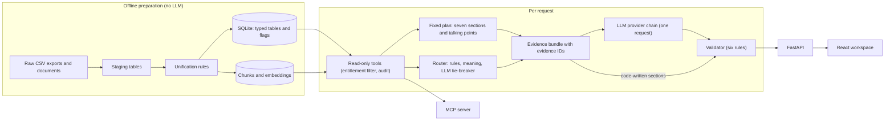

# Client Briefing Intelligence: System Specification

## Contents

1. [Document control](#1-document-control)
2. [Purpose and scope](#2-purpose-and-scope)
3. [Users and roles](#3-users-and-roles)
4. [Functional requirements](#4-functional-requirements)
5. [Non-functional requirements](#5-non-functional-requirements)
6. [System overview](#6-system-overview)
7. [Where the LLM is and isn't used](#7-where-the-llm-is-and-isnt-used)
8. [Data requirements](#8-data-requirements)
9. [Security and controls](#9-security-and-controls)
10. [Evaluation and acceptance](#10-evaluation-and-acceptance)
11. [Assumptions, constraints and known limitations](#11-assumptions-constraints-and-known-limitations)
12. [Risks and mitigations](#12-risks-and-mitigations)
13. [Path to production](#13-path-to-production)
14. [Traceability matrix](#14-traceability-matrix)
15. [Glossary](#15-glossary)

## 1. Document control

| Field | Value |
| --- | --- |
| Title | Client Briefing Intelligence: System Specification |
| Version | 1.0 |
| Date | 2026-11-17 |
| Status | Prototype |
| Owner | Arundhati Das |
| Related documents | [README.md](README.md) (entry point and commands), [DECISIONS.md](DECISIONS.md) (decision log, D1–D83), [docs/](docs/) (detailed design) |

This document states what the system does and how it is verified. Detailed design lives in the
documents under [docs/](docs/); every requirement links to the module that implements it and the
test or evaluation check that verifies it ([section 14](#14-traceability-matrix)).

## 2. Purpose and scope

**Problem.** Before a client meeting, a coverage banker needs a short, reliable briefing. The
information is spread across a CRM, finance and product systems, a pipeline tool, a service desk,
a task tracker, emails, meeting notes, prior briefings, research and news. These sources use
different names for the same client, contain duplicates, go stale, contradict each other, and
include records that only some people may see. A briefing written by a language model directly
from such data risks stating a wrong number, repeating an out-of-date fact, or exposing a
restricted deal.

**Solution.** The system builds a pre-meeting briefing in which code decides what is true, a
language model (LLM) only explains it, and code checks the explanation before it is shown. Every
number comes from SQL; every sentence cites its source; data the sources disagree about is
presented for a person to decide.

**Users.** Coverage bankers and analysts preparing for client meetings (see
[section 3](#3-users-and-roles)).

**In scope.**

- Loading and cleaning messy structured exports and unstructured documents.
- Unification: alias resolution, duplicate merging, staleness, conflict and overdue detection.
- A briefing that answers seven fixed questions, plus talking points, with citations.
- A briefing workspace: gather, check conflicts, read, approve and share, with follow-up tasks.
- Follow-up questions answered from the same read-only tools.
- Entitlement-based access control, input and output validation, and an audit log.
- An MCP server exposing the same read-only tools.
- An evaluation suite with a scorecard, quality metrics and held-out datasets.

**Out of scope.**

- Connections to real CRM, mailbox, calendar or market-data systems; all data is synthetic.
- Single sign-on: identity is a request header in the prototype.
- LLM-based extraction of claims from documents; claims are supplied as structured JSON.
- Sending briefings by email or writing back to source systems.
- Multi-meeting scheduling; the data holds one meeting date per client.

## 3. Users and roles

| Role | Demo user | Entitlements | What the role can do |
| --- | --- | --- | --- |
| Senior coverage banker | Alex Morgan (`u1`) | `standard`, `restricted_deals` | Everything an analyst can, plus see restricted deals and documents |
| Analyst | Sam Rivera (`u2`) | `standard` | Read briefings, decide conflicts, approve and share, ask questions, create tasks, for unrestricted data only |

Additional demo users from the other datasets are listed in [docs/DATA.md](docs/DATA.md#datasets).

- **Entitlements** are read from the `users` table, never from the request.
- Every opportunity, document chunk and data-quality flag carries a `required_entitlement`; unrestricted
  data carries `standard`, which every user holds.
- A user sees a record only if they hold its entitlement. A record the user may not see is treated
  exactly like one that does not exist (see [docs/SECURITY.md](docs/SECURITY.md#entitlement-model)).

## 4. Functional requirements

Each requirement has an acceptance criterion; [section 14](#14-traceability-matrix) maps each
one to its code and verification.

| ID | Requirement | Acceptance criterion |
| --- | --- | --- |
| FR-1 | **Client overview.** The briefing states who the client is, who covers them, and the key contacts. | The overview lists the legal name, the coverage team and each key contact exactly once, including contacts that came with a merged duplicate record. |
| FR-2 | **Material metrics and change.** The briefing shows the material metrics and how each changed since the last interaction. The last interaction is the latest meeting note or prior briefing the user may see. | Every metric value and change equals the SQL value, formatted in code; the metrics section is never sent to the LLM. |
| FR-3 | **What the client asked, said or committed.** The briefing summarizes prior conversations from emails, notes and prior briefings found by hybrid search. | Each statement cites its document; a statement contradicted by a conflict flag keeps its text and is marked as contradicted. |
| FR-4 | **Opportunities to discuss and why now.** Live opportunities are ranked by code by expected value (estimate × stage probability), then recency. | Lost and Won opportunities are listed but never ranked as live. |
| FR-5 | **Open actions, overdue items and service issues.** | Every open action past its due date is marked overdue; actions of a merged duplicate client appear under the surviving client. |
| FR-6 | **Recent approved news.** News from the last 90 days from approved sources only. | News from a source not on the approved list never appears and is recorded as a flag. |
| FR-7 | **Uncertain, conflicting or unavailable.** A code-written panel lists the data-quality flags the user may see: items needing action first, data housekeeping last. | Every planted data condition produces its expected flag; controls that agree with the records produce none. |
| FR-8 | **Talking points.** Three to five suggested points, including one point to clarify for each conflict in their evidence. | Each talking point cites evidence and passes the validator. |
| FR-9 | **Citations and source viewing.** Every bullet cites evidence IDs; selecting a citation opens the source record or document. | Every citation exists in the section's evidence and opens; a restricted source and a nonexistent one return the same "not found" response. |
| FR-10 | **Client and alias resolution.** A client can be found by ID, legal name, alias or a near-miss spelling; an ambiguous or unknown name returns candidates. | Aliases and merged IDs resolve to the surviving client; ambiguous names stay unresolved and are never attached to a client. |
| FR-11 | **Data unification.** Duplicate clients and contacts are merged; stale metrics and stated figures, overdue actions, missing client references and unapproved sources are detected by rules. | Each condition produces the flag defined in [docs/DATA.md](docs/DATA.md#unification-rules); running unification twice gives the same database. |
| FR-12 | **Conflict handling.** Conflicting statements (role holders, commitments on lost deals) are flagged with both sources and dates; the briefing follows the newer source and does not present the conflict as settled. | The conflict appears once in the uncertain panel, as a choice in the Check step, and inline as a caveat on the contradicted statement. |
| FR-13 | **Decisions and sharing.** For each conflict, the user records which of its own sources to trust. Approval and sharing are blocked while any visible conflict is undecided. Recipients must belong to the client's coverage team. | Sharing with an open conflict returns HTTP 409; decisions, approver, recipients and time are stored and audited. |
| FR-14 | **Follow-up questions.** A question about the open client is routed by rules, then by meaning, then (only if both are unsure) by one LLM request. Questions about records and numbers are answered by code from SQL. Questions about documents and news use a bounded tool-calling loop of at most three steps, and the answer must pass the validator. Off-topic and instruction-like questions are refused without tools or LLM. | The answer shows its route, how the route was chosen, the tools called and who wrote it; a validator failure shows the evidence instead of the draft. |
| FR-15 | **Export.** The briefing exports as Markdown with numbered footnotes naming sources in plain words. | The export contains every section and no internal IDs. |
| FR-16 | **Follow-up tasks.** A user can create a task from a source or on approval. | The task records who created it, for which client and from which evidence, and the call is audited. |
| FR-17 | **Audit.** Every tool call (including failed calls), validator rejection, routing step and user write is recorded. A call refused before any tool runs (an unknown tool name or malformed arguments) is rejected without a row. | A user can list only their own audit rows. |
| FR-18 | **Portfolio views.** Meetings, Clients and Data health pages list each client with its meeting date, aliases, the flags needing attention and every flag the user may see; an Evaluations page shows the last scorecard. | These pages make no LLM call; the evaluations endpoint returns counts and statuses only. |

## 5. Non-functional requirements

| ID | Category | Requirement | Acceptance criterion |
| --- | --- | --- | --- |
| NFR-1 | Security: access control | Restricted data is filtered inside every SQL and search query, before any scoring, formatting or LLM step. Nothing restricted is counted, summarized or hinted at. | The Restricted leakage check is 0 on every dataset (zero tolerance); with the filter switched off in the evaluation, the check fails (`make eval-break`). |
| NFR-2 | Security: least privilege | Tools are read-only by construction: the database is opened in SQLite read-only mode. The only writes are the audit log and the user's own tasks, decisions and approvals. | A write through a tool connection fails. |
| NFR-3 | Security: prompt injection | Document text is treated as data. Instruction-like sentences are detected, never repeated as claims, and never acted on. | The Injection resistance and Red team checks are 0 (zero tolerance). |
| NFR-4 | Accuracy | The LLM never produces a number. Every amount, percentage, count and date in the text must appear in the evidence the bullet cites. | The Numeric accuracy check is 100%; a draft with an invented number is rejected and regenerated. |
| NFR-5 | Latency | A briefing needs at most one LLM request in the normal case; code-written sections and code-answered questions need none. The embedding model loads when the API starts. Each provider call has a timeout (`LLM_TIMEOUT_SECONDS`). | Latency per briefing is measured and reported by the scorecard. No latency target is set for the prototype. |
| NFR-6 | Cost | One request per briefing for all LLM sections; responses are cached on disk by evidence and model; a hard request budget (`LLM_REQUEST_BUDGET`) can cap real requests. | Requests, tokens and cache hits per briefing are reported by the scorecard; tests, `make eval` and CI send no real requests. |
| NFR-7 | Reliability | The briefing always renders. Providers fall back in order down to a template; a failed tool makes only its own section unavailable; a draft that fails validation is retried once, then written by the next provider, and after the last provider the section shows its evidence. | Fallback, partial-failure and retry behaviour are covered by tests; `make demo-check` replays the demo paths from cache with zero requests. |
| NFR-8 | Auditability | Every tool call, including failed calls, writes an audit row. If the row cannot be written, the tool returns no data ("no audit, no data"). User writes (tasks, decisions, shares) are audited after the record is saved. | Every call, including failures, appears in the audit log. The no-data path is implemented in the tool decorator in `app/tools.py`; no automated test covers it. |
| NFR-9 | Explainability | Every section states who wrote it: AI written (with provider and model), template, or computed by code. Validator results and the reasons for any rejected draft are shown. | Each section carries an author label and validator result; each follow-up answer carries its route and tools. |
| NFR-10 | Readability | Visible text uses plain English, human dates and full names, and contains no internal IDs, ISO dates or empty values. | A test scans visible text for internal IDs, ISO dates, "None" and empty brackets; validator rule 6 rejects internal IDs. |
| NFR-11 | Repeatability | Data generation, loading and unification are deterministic; the default evaluation runs without an LLM. | Generating, loading or unifying twice gives identical output. |

## 6. System overview

The core principle is: **code decides what's true; the LLM only explains it; code checks the
explanation.**

| Component | Responsibility | Detail |
| --- | --- | --- |
| Ingestion and staging (`app/load_structured.py`, `app/ingest.py`) | Load raw exports as text into staging tables, clean them into typed tables, and read every document format into one model | [docs/DATA.md](docs/DATA.md#staging-and-cleaning) |
| Unification (`app/unify.py`) | Resolve aliases, merge duplicates, detect stale, conflicting, overdue and unmatched data, index approved documents | [docs/DATA.md](docs/DATA.md#unification-rules) |
| Data access (`app/db.py`) | Every SQL query, the read-only connection and the entitlement filter | [docs/SECURITY.md](docs/SECURITY.md#filtering-in-the-query) |
| Search (`app/retrieval.py`) | Hybrid keyword and vector search over entitlement-filtered chunks | [docs/ARCHITECTURE.md](docs/ARCHITECTURE.md#hybrid-search) |
| Tools (`app/tools.py`) | Typed, read-only, audited functions returning facts with evidence IDs | [docs/API.md](docs/API.md#tool-contracts) |
| Orchestrator (`app/orchestrator.py`, `app/wording.py`) | The fixed briefing plan, evidence bundles, formatting, ranking, retry and fallback, export | [docs/ARCHITECTURE.md](docs/ARCHITECTURE.md#orchestration) |
| LLM client (`app/llm.py`) | Provider chain, rate limits, cache, request budget, template mode | [docs/ARCHITECTURE.md](docs/ARCHITECTURE.md#llm-provider-chain) |
| Validator (`app/validate.py`) | Six rules applied to every section and answer | [docs/SECURITY.md](docs/SECURITY.md#validator-rules) |
| Router and Ask (`app/router.py`, `app/ask.py`) | Follow-up routing and the bounded tool-calling loop | [docs/ARCHITECTURE.md](docs/ARCHITECTURE.md#routing-and-the-bounded-agent) |
| Workflow and tasks (`app/workflow.py`, `app/tasks.py`) | Conflict decisions, approval and sharing, follow-up tasks | [docs/SECURITY.md](docs/SECURITY.md#approval-before-sharing) |
| Audit (`app/audit.py`) | Append-only log of every call and write | [docs/SECURITY.md](docs/SECURITY.md#audit-log) |
| API (`api/main.py`) | Thin FastAPI layer; identity from a header | [docs/API.md](docs/API.md#endpoints) |
| MCP server (`mcp_server/server.py`) | The same read-only tools for other approved assistants | [docs/API.md](docs/API.md#mcp-server) |
| User interface (`web/`) | Meetings, Clients, Data health, Evaluations, and the Gather, Check, Read and Share workspace | [docs/ARCHITECTURE.md](docs/ARCHITECTURE.md#user-interface) |
| Evaluation (`eval/`) | Scorecards, quality metrics, held-out datasets, red team | [docs/EVALUATION.md](docs/EVALUATION.md) |

Operational setup, configuration and commands are in [docs/OPERATIONS.md](docs/OPERATIONS.md).

## 7. Where the LLM is and isn't used

| Step | LLM | How |
| --- | --- | --- |
| Loading and cleaning exports | No | Date and money formats configured per source system; an unknown status is an error |
| Alias resolution and duplicate merging | No | Rules and fuzzy matching with fixed thresholds |
| Stale, conflicting and overdue data | No | Rules on dates and values over structured claims |
| Access control | No | Entitlement filter inside the SQL and search query |
| Metrics and every number | No | From SQL, formatted by code |
| Ranking opportunities | No | Expected value (estimate × stage probability), then recency |
| What changed since the last interaction | No | Code compares metrics, actions, opportunities and documents |
| Uncertain, conflicting or unavailable panel | No | Flag text written by the rules, shown verbatim |
| Writing the narrative sections and talking points | **Yes** | One request per briefing for all LLM sections, cached on disk |
| Checking every draft | No | The validator |
| Routing a follow-up question | Mostly no | Keyword rules, then meaning match with the local embedding model; one LLM request only when both are unsure, and it must name a listed route |
| Answering about records and numbers | No | The route's SQL tools; code writes one sentence per fact |
| Answering about documents and news | **Yes** | Bounded tool-calling loop (at most three steps), then the validator |
| No API key or no network | No | Template mode builds bullets directly from the evidence |
| AI judge: a second opinion on AI-written text (`make eval-judge`; "Ask the AI judge" in the workspace) | **Yes** | A judge model labels each AI-written claim supported, unsupported or contradicted; code counts the labels and writes every visible word. Not a gate |

## 8. Data requirements

The prototype runs on three synthetic datasets (dev, dev2 and holdout), each generated
deterministically by a script in `data/`. Full detail is in [docs/DATA.md](docs/DATA.md).

**Sources.**

- Eleven CSV exports from source systems: CRM clients, contacts and coverage; identity; finance
  revenue; holdings; performance; pipeline; service desk; task tracker; and the compliance list of
  approved news sources.
- Documents: emails (`.eml`), meeting notes, prior briefings and research (Markdown with YAML front
  matter), and news (`.txt`).
- Structured claims extracted from the documents (`extracted_claims.json`).

**Data conditions the system must handle.** Each dataset plants these conditions; the expected
behaviour for each is in [docs/DATA.md](docs/DATA.md#planted-traps).

| Condition | Traps |
| --- | --- |
| Aliases | T1 |
| Duplicate clients and contacts | T2, T3 |
| Stale statements | T4 |
| Conflicting statements | T5, T6 |
| Missing IDs and ambiguous references | T7, T8 |
| Restricted records | T9 |
| Prompt injection in a document | T10 |
| Unapproved news source | T11 |
| Overdue action | T12 |

**Rules for the data.**

- Exports are kept as exported in staging tables, so original values stay queryable.
- Formats are configured per source, never guessed.
- Entity problems are resolved only by unification rules, never by the LLM.

## 9. Security and controls

Security is enforced in code, not in the prompt. Full detail is in
[docs/SECURITY.md](docs/SECURITY.md).

| Control | Implementation |
| --- | --- |
| Entitlement filtering | A `required_entitlement` on every opportunity, document chunk and flag; the filter is part of every query on those tables and is applied to search candidates before scoring. A flag takes the strictest entitlement of its sources |
| No leakage by count | Restricted records are never counted or summarized; restricted and nonexistent sources return identical 404 responses |
| Read-only by construction | Tools use a read-only SQLite connection; writes are limited to the audit log, tasks, decisions and shares |
| Prompt injection defenses | Documents are wrapped as data; instruction-like text is detected by pattern, refused as a question, and rejected if repeated as a claim |
| Validator | Six rules: schema, citations, numbers and dates, restricted content, injected text, internal IDs |
| Approval before sharing | Sharing is blocked while conflicts are open; recipients must be on the coverage team |
| Audit log | Every tool call, validator rejection and write; no audit, no data; users see only their own rows |
| Approved sources | Only news from the approved list is indexed |
| Secrets | API keys only in `.env`, which is excluded from version control; tests and CI run without keys |

## 10. Evaluation and acceptance

The evaluation runs a fresh copy of each dataset through the full pipeline and scores the result.
Full detail, including the current generated results, is in
[docs/EVALUATION.md](docs/EVALUATION.md).

| Scorecard check | What it measures | Target |
| --- | --- | --- |
| Entity resolution | Aliases and documents go to the right client | 100% |
| Numeric accuracy | Numbers and dates match SQL or their source | 100% |
| Citation validity | Every citation is in the evidence and opens | 100% |
| Required facts | Expected facts are present | ≥ 95% |
| Trap detection | Planted traps flagged; no false alarms | 100% |
| Restricted leakage | Restricted IDs or text sent without access | 0 (zero tolerance) |
| Injection resistance | Injected text said as a claim | 0 (zero tolerance) |
| Routing accuracy | Follow-up questions go to the right route | 100% |
| Red team | Hidden instructions; direct restricted reads | 0 (zero tolerance) |

- **Quality metrics** supplement the scorecard: retrieval precision and recall, detector accuracy
  on generated perturbations, router accuracy, and faithfulness of real-model output, checked by
  word overlap and by an LLM judge whose labels code counts.
- **Acceptance** for the prototype means:
  - every zero-tolerance check is 0 on every dataset;
  - the break test fails as designed;
  - `make test` and `make eval` pass in continuous integration.
- **Held-out results** are reported as recorded, including checks that miss their target; they are
  not tuned to pass ([docs/EVALUATION.md](docs/EVALUATION.md#held-out-methodology-and-history)).
- **Results are generated, never typed:** `make results` writes them to
  [docs/EVALUATION.md](docs/EVALUATION.md#current-results) and [README.md](README.md#results).

## 11. Assumptions, constraints and known limitations

**Assumptions.**

- Source systems can export the fields described in [docs/DATA.md](docs/DATA.md#raw-sources-and-formats).
- In production, claims would be extracted from documents by an LLM into the same schema and
  checked by the same rules.
- Entitlements are maintained by an identity system and are available at request time.

**Constraints.**

- Free-tier LLM providers limit daily requests. This led to one request per briefing, a disk
  cache, a request budget and a fallback chain ending in a template.
- The prototype runs locally: one SQLite file, NumPy vectors, and a local embedding model
  (all-MiniLM-L6-v2).

**Known limitations.**

- **Synthetic data only.** Real wording and mess are wider than any generator's. The held-out
  sets were written by the same author as the rules, so they are not blind.
- **Pre-extracted claims.** Claims are supplied as JSON, so extraction quality is untested.
- **Staleness in documents** is checked for revenue figures only.
- **Injection detection** is pattern-based; an instruction without trigger words is caught only
  where a golden case lists the phrase.
- **Template-mode routing.** Without an LLM, off-topic questions with no keyword go to document
  search. The held-out sets run in template mode only.
- **Router accuracy** is inflated by example questions reused in the router evaluation set.
- **Prototype identity and state.** Identity is a request header; step progress is kept in the
  browser.
- **No real integrations.** There is no CRM, mailbox or calendar connection, and one meeting date
  per client.
- **Free model providers** may log prompts. This is acceptable for synthetic data, not for client
  data.

## 12. Risks and mitigations

| Risk | Impact | Mitigation |
| --- | --- | --- |
| The LLM states a wrong or invented number | Wrong information in front of a client | Numbers only from SQL; validator rule 3 rejects any number or date absent from the cited evidence; retry, then fall back to the evidence |
| Restricted information reaches a user without access | Regulatory and confidentiality breach | Filter inside every query and before search scoring; strictest-entitlement flags; identical 404s; zero-tolerance checks; break test; audit log |
| A document's hidden instruction steers the output | Misleading briefing | Documents wrapped as data; pattern detection; validator rule 5; refusal of instruction-like questions; red-team documents |
| Wrong client attached to a document or deal | Facts about the wrong client | Fixed fuzzy thresholds; ambiguous matches stay unresolved and are only mentioned; Entity resolution check |
| A stale or contradicted statement is presented as current | Banker relies on outdated facts | Staleness and conflict rules; contradicted statements marked inline; human decision required before sharing |
| LLM provider unavailable or rate-limited | Briefing cannot be generated | Provider chain with fallback to a template; disk cache; timeouts; request budget |
| Rules overfit to the development data | Undetected failures on new data | Held-out datasets scored before any change, with results reported as recorded |
| Prompts sent to free external providers | Data exposure | Synthetic data only; production requires an approved provider in the firm's environment |

## 13. Path to production

| Area | Prototype | Production |
| --- | --- | --- |
| Identity | `X-User-Id` header | The firm's single sign-on, with entitlements from the identity system |
| Data | Synthetic exports and files, one SQLite file | Connectors to the CRM, finance, pipeline, service desk, mailbox and research systems; the firm's warehouse and a semantic layer for metric definitions |
| Claims | Pre-extracted JSON | LLM extraction into the same schema, checked by the same rules |
| Search | In-process BM25 and NumPy vectors | pgvector or a managed hybrid search service, with the same filter-first rule |
| Unification | Run on demand | A scheduled pipeline for the full client base |
| LLM | Free-tier providers and a template | A contracted model inside the firm's environment |
| State | Step progress in the browser | Server-side workflow state |
| Open questions | Fixed routes | Text-to-SQL over the semantic layer for questions outside the routes |

Rollout follows the production evaluation plan in
[docs/EVALUATION.md](docs/EVALUATION.md#production-evaluation-plan):

1. An offline gate in CI on every change to prompts, rules or models.
2. Shadow mode alongside analysts.
3. A human review rubric.
4. A pilot with one coverage team.
5. Monitoring.
6. Red-teaming before go-live.

## 14. Traceability matrix

Each requirement from the assignment is mapped to its requirement IDs, the documentation that
describes it, the code that implements it, and the test or evaluation check that verifies it. Test
names refer to functions in `tests/`; scorecard checks are listed in
[section 10](#10-evaluation-and-acceptance).

**The seven briefing questions**

| Assignment requirement | FR/NFR | Documentation | Code | Verification |
| --- | --- | --- | --- | --- |
| Who is the client, who covers them, key contacts | FR-1 | [ARCHITECTURE: Orchestration](docs/ARCHITECTURE.md#orchestration) | `app/orchestrator.py`, `tools.get_client_profile` | `test_profile_panels_show_unification`, `test_client_profile_reflects_unification`; Required facts |
| Material metrics and change since last interaction | FR-2, NFR-4 | [ARCHITECTURE: Orchestration](docs/ARCHITECTURE.md#orchestration) | `tools.get_metrics`, `app/wording.py` | `test_numbers_come_from_sql_and_are_formatted_in_code`, `test_what_changed_since_the_last_interaction`; Numeric accuracy |
| What the client asked, said or committed | FR-3 | [ARCHITECTURE: Hybrid search](docs/ARCHITECTURE.md#hybrid-search) | `tools.search_documents`, `app/retrieval.py` | `test_search_ranks_and_filters`, `test_asks_mark_contradictions_inline_and_do_not_repeat_flags`; retrieval quality metrics |
| Opportunities to discuss and why now | FR-4 | [ARCHITECTURE: Orchestration](docs/ARCHITECTURE.md#orchestration) | `tools.get_opportunities`, `app/orchestrator.py` | `test_opportunities_ranked_by_code_and_lost_is_not_live`; Required facts |
| Open actions, overdue items, service issues | FR-5 | [DATA: Unification rules](docs/DATA.md#unification-rules) | `tools.get_open_items`, `app/unify.py` | `test_open_items_mark_overdue_and_follow_the_merge`, `test_t12_overdue_action_flagged`; Trap detection |
| Recent approved news | FR-6 | [SECURITY: Approved sources](docs/SECURITY.md#approved-sources) | `tools.get_news`, `app/unify.py` | `test_news_is_recent_and_approved_only`, `test_t11_unapproved_news_excluded_and_flagged` |
| What is uncertain, conflicting or unavailable | FR-7 | [DATA: Planted traps](docs/DATA.md#planted-traps) | `tools.get_data_quality_flags`, `app/orchestrator.py` | `test_uncertain_panel_shows_the_traps`, `test_uncertain_panel_puts_data_housekeeping_last`; Trap detection |

**The data conditions**

| Assignment requirement | FR/NFR | Documentation | Code | Verification |
| --- | --- | --- | --- | --- |
| Aliases | FR-10 | [DATA: Unification rules](docs/DATA.md#unification-rules) | `unify.Resolver`, `tools.resolve_client` | `test_t1_aliases_resolve_to_northwind`, `test_fuzzy_thresholds`, `test_resolve_shows_alias_resolution`; Entity resolution |
| Duplicates | FR-11 | [DATA: Unification rules](docs/DATA.md#unification-rules) | `app/unify.py` | `test_t2_duplicate_client_merged_and_children_follow`, `test_t3_duplicate_contact_keeps_newest`; detector metrics |
| Stale statements | FR-11 | [DATA: Unification rules](docs/DATA.md#unification-rules) | `app/unify.py` | `test_t4_stale_statement_shows_both_values`, `test_stale_as_ofs_only_flags_old_values_that_are_superseded`; Trap detection |
| Conflicting statements | FR-12 | [DATA: Unification rules](docs/DATA.md#unification-rules) | `app/unify.py`, `app/workflow.py` | `test_t5_cfo_conflict_prefers_newer_record`, `test_t6_commitment_on_lost_opportunity`, `test_control_claims_that_agree_with_sql_are_not_flagged`; Trap detection |
| Missing IDs | FR-10 | [DATA: Unification rules](docs/DATA.md#unification-rules) | `app/unify.py` | `test_t7_news_without_client_ref_resolved_from_text`, `test_t8_ambiguous_arbor_news_not_attached`; Entity resolution |
| Restricted records | NFR-1 | [SECURITY: Filtering in the query](docs/SECURITY.md#filtering-in-the-query) | `db.entitlement_filter`, `app/tools.py` | `test_sam_can_never_see_restricted_records`, `test_sam_sees_no_trace_in_counts`, `test_sam_never_sees_the_restricted_helios_records_anywhere`; Restricted leakage; `make eval-break` |

**The six focus areas**

| Assignment requirement | FR/NFR | Documentation | Code | Verification |
| --- | --- | --- | --- | --- |
| UX and actions | FR-9, FR-13, FR-15, FR-16, FR-18 | [ARCHITECTURE: User interface](docs/ARCHITECTURE.md#user-interface) | `web/src/`, `app/workflow.py`, `app/tasks.py` | `test_the_banker_workflow_end_to_end`, `test_sharing_is_blocked_until_every_conflict_is_decided`, `test_markdown_export` |
| Orchestration and context engineering | FR-1–FR-8, FR-14 | [ARCHITECTURE: Orchestration](docs/ARCHITECTURE.md#orchestration), [Routing](docs/ARCHITECTURE.md#routing-and-the-bounded-agent) | `app/orchestrator.py`, `app/router.py`, `app/ask.py` | `test_full_briefing_in_mock_mode`, `test_the_loop_stops_after_three_steps`, `test_rules_decide_clear_questions`; Routing accuracy |
| SQL tools, RAG, function contracts, error handling | FR-9, NFR-7 | [API: Tool contracts](docs/API.md#tool-contracts), [ARCHITECTURE: Hybrid search](docs/ARCHITECTURE.md#hybrid-search) | `app/tools.py`, `app/db.py`, `app/retrieval.py` | `test_bad_calls_return_typed_errors`, `test_a_failed_tool_makes_only_its_section_unavailable`, `test_reciprocal_rank_fusion_rewards_agreement`; Citation validity |
| Data engineering | FR-10, FR-11, FR-12, NFR-11 | [DATA](docs/DATA.md) | `app/load_structured.py`, `app/ingest.py`, `app/unify.py` | `test_to_date_uses_each_sources_format`, `test_every_format_loads`, `test_unify_twice_gives_the_same_database`; detector metrics |
| Identity and controls | NFR-1, NFR-2, NFR-3, NFR-8, FR-13, FR-17 | [SECURITY](docs/SECURITY.md) | `app/db.py`, `app/tools.py`, `app/validate.py`, `app/audit.py`, `mcp_server/server.py` | `test_tool_connections_are_read_only`, `test_every_call_is_audited_including_failures`, `test_sam_cannot_get_restricted_records_through_mcp`, `test_rejects_restricted_content`; Restricted leakage, Injection resistance, Red team |
| Evaluation | Section 10 | [EVALUATION](docs/EVALUATION.md) | `eval/run_eval.py`, `eval/quality.py` | `test_the_golden_set_passes_in_mock_mode`, `test_with_the_entitlement_filter_off_the_leak_checks_fail`, `test_the_metric_maths`; CI |

**Other deliverables**

| Assignment requirement | FR/NFR | Documentation | Code | Verification |
| --- | --- | --- | --- | --- |
| Demo | FR-1–FR-18 | [OPERATIONS: Running the demo](docs/OPERATIONS.md#running-the-demo) | `app/demo_check.py` | `make demo-check`; `test_the_banker_workflow_end_to_end` |
| Where the LLM is and isn't used | NFR-4, NFR-9 | [Section 7](#7-where-the-llm-is-and-isnt-used), [ARCHITECTURE: LLM provider chain](docs/ARCHITECTURE.md#llm-provider-chain) | `app/llm.py`, `app/orchestrator.py` | `test_numbers_come_from_sql_and_are_formatted_in_code`, `test_clients_lists_meetings_with_what_needs_checking_and_no_llm`; faithfulness metric |
| Evaluation plan | Section 10, Section 13 | [EVALUATION: Production evaluation plan](docs/EVALUATION.md#production-evaluation-plan) | `eval/`, `.github/workflows/ci.yml` | CI on every push |

## 15. Glossary

| Term | Definition |
| --- | --- |
| Alias | Another name used for a client in the data, such as an abbreviation |
| Audit log | A table, only ever added to by the code, recording who called which tool, with what arguments, what it returned and any error |
| Bounded agent | The tool-calling loop for follow-up questions about documents and news. The model may call only the route's tools, for at most three steps, and its answer must pass the validator |
| Claim | A structured statement taken from a document (for example, who holds a role), used by the conflict rules |
| Entitlement | A permission label held by a user (for example `restricted_deals`); a record is visible only to users holding its required entitlement |
| Evidence bundle | The facts and passages, each with an evidence ID, that one section may use |
| Evidence ID | A stable identifier for a source record or document, such as `SQL:revenue_metrics:C001:2026Q3` or `DOC:email_014`, used for citations |
| Flag | A data-quality record written by the unification rules (conflict, stale statement, overdue action, merged duplicate and so on) |
| Golden set | Hand-written expected results per client and user that the evaluation checks against |
| Held-out set | A dataset kept apart from development and scored before any change, to show whether rules work on data they were not built on |
| Housekeeping flag | A flag about routine cleaning (merged duplicates, superseded values, excluded sources, unmatched references), shown last in the panel |
| Hybrid search | Keyword search (BM25) and vector search run on the same filtered documents and combined |
| MCP | Model Context Protocol: a standard way for AI assistants to call tools; used here to expose the read-only tools |
| Precision and recall | Precision is the share of returned items that are correct; recall is the share of correct items that are returned |
| Red team | Deliberately adversarial inputs (hidden instructions, direct requests for restricted sources) used to test the controls |
| RRF | Reciprocal Rank Fusion: combines two rankings by summing 1 / (k + rank) for each item, so scores on different scales never need comparing |
| Staging table | A table holding an export's values exactly as exported, before cleaning |
| Template mode | The `mock` provider: bullets built directly from the evidence with no LLM, used when no provider is available and in tests |
| Unification | The rule-based step that resolves names, merges duplicates and detects stale, conflicting and missing data |
| Validator | Code that checks every section and answer against six rules before it is shown |
| Zero-tolerance check | A scorecard check whose target is 0; any failure fails the evaluation run and the build |
