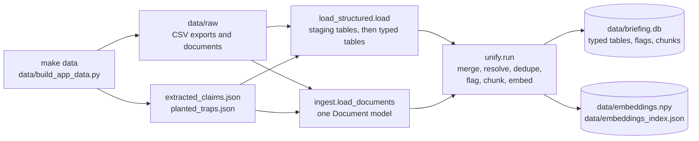
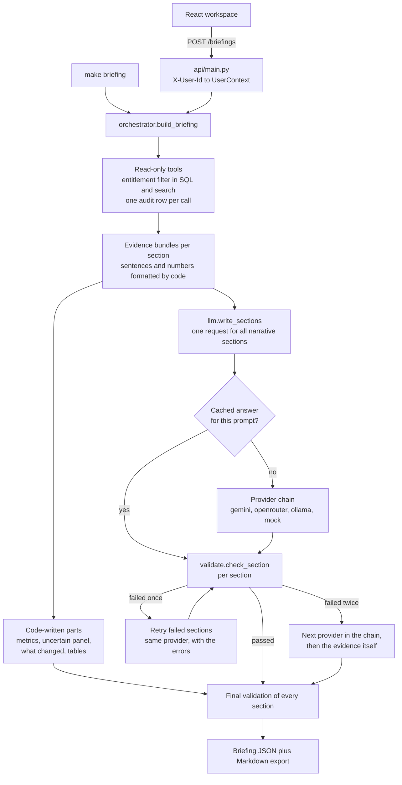
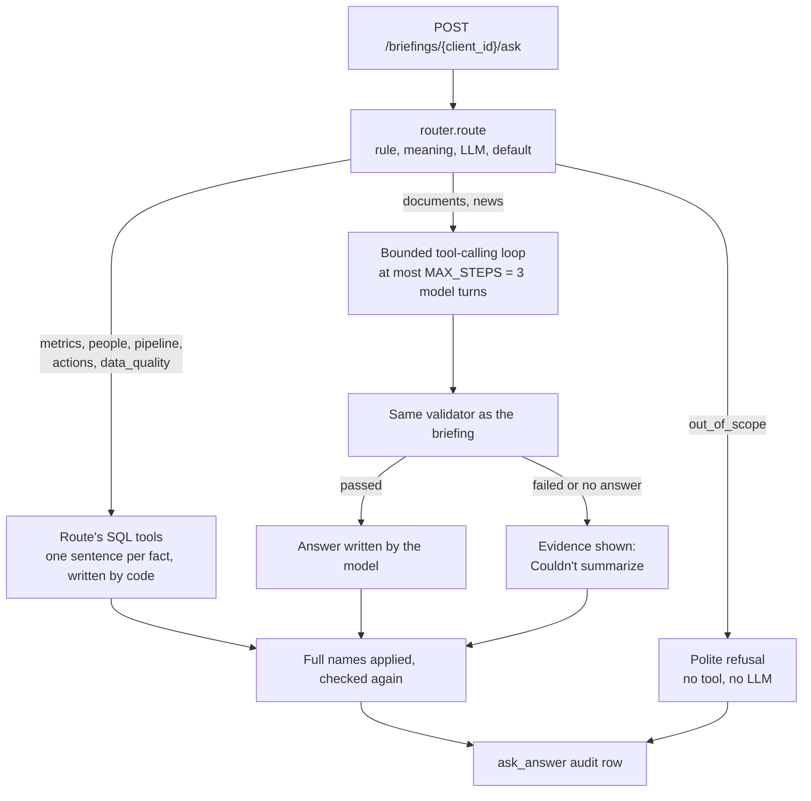

# Architecture

Client Briefing Intelligence builds a pre-meeting client briefing from CRM exports, metrics, notes, emails and news. The system is split into an offline preparation stage, which loads, cleans and unifies the raw data into a SQLite database and an embedding index using rules only, and a per-request stage, which gathers evidence through read-only, entitlement-filtered tools, writes the numeric and rule-based parts in code, asks an LLM to word the narrative sections in a single request, and checks every sentence with a validator before it reaches a reader. Follow-up questions are routed to a fixed set of routes: records and numbers are answered by code from SQL, and only document and news questions use a bounded tool-calling loop. A FastAPI backend serves the logic to a React workspace and the same read-only tools are exposed over MCP. This document describes the components, how data moves through them, and where the prototype differs from a production deployment.

**Contents**

- [Components](#components)
- [Data flow](#data-flow)
- [Orchestration](#orchestration)
- [Hybrid search](#hybrid-search)
- [LLM provider chain](#llm-provider-chain)
- [Caching](#caching)
- [Routing and the bounded agent](#routing-and-the-bounded-agent)
- [User interface](#user-interface)
- [Prototype vs production](#prototype-vs-production)

## Components

All business logic lives in `app/`. The API, the evaluation harness, the MCP server and the command-line entry points are thin layers over it, so tests and the evaluation never need the frontend.

| Layer | Module | Responsibility |
| --- | --- | --- |
| Preparation | `app/load_structured.py` | Rebuilds `data/briefing.db` from `data/raw/*.csv`: copies each CSV unchanged into a `stg_<file>` staging table (all `TEXT`), then cleans dates (format configured per source in `DATE_FORMATS`), money and statuses into typed tables. An unknown status raises an error. |
| Preparation | `app/ingest.py` | Parses every document format (`.eml`, Markdown with YAML front matter, `.txt` news) into one `Document` model and attaches its structured claims from `extracted_claims.json`. |
| Preparation | `app/unify.py` | Rule-based unification, no LLM: merges duplicate clients, resolves client references, removes duplicate contacts, flags stale data, overdue actions and conflicts into `data_quality_flags`, chunks every resolved document (news only from approved sources) and embeds each chunk. |
| Shared | `app/wording.py` | Formats every date, amount, percentage and label for people (for example `format_usd`, `day_month`, `metric_label`). Defines `AS_OF_DATE` (2026-11-18), the demo "today" and meeting date. |
| Data access | `app/db.py` | Every SQL query the tools run. Opens SQLite read-only (`mode=ro`) and applies the entitlement filter inside the `WHERE` clause for the tables that can hold restricted rows (opportunities, chunks, data-quality flags). |
| Data access | `app/retrieval.py` | Hybrid document search: filter first in SQL, then BM25Plus and vector rankings merged by Reciprocal Rank Fusion. Loads the `all-MiniLM-L6-v2` embedding model. |
| Data access | `app/tools.py` | The typed, read-only tools (`resolve_client`, `get_client_profile`, `get_metrics`, `get_opportunities`, `get_open_items`, `search_documents`, `get_news`, `get_data_quality_flags`), plus `get_source` for citation chips and `get_metric_history` for the Clients page. One `@tool` decorator validates input with Pydantic, converts failures into typed errors and writes the audit row. |
| Data access | `app/audit.py` | Appends one `audit_log` row per tool call (user, tool, arguments, result evidence IDs, error) and returns a user's recent rows. A tool returns no facts if its audit row cannot be written. |
| Briefing | `app/orchestrator.py` | The fixed briefing plan: calls the tools, builds per-section evidence bundles, writes the code sections, asks the LLM for the narrative sections, validates, retries and falls back, and renders the Markdown export. Also the `make briefing` command line. |
| Briefing | `app/llm.py` | The LLM client: prompt construction, the provider chain (`LLM_CHAIN`), rate limits, retry and fallback, the on-disk answer cache, the request budget and the template (mock) writer. |
| Briefing | `app/validate.py` | The contract between code and the LLM: the draft schema and the checks on every bullet (citations, numbers and dates, restricted content, injected instructions, internal IDs). |
| Follow-ups | `app/router.py` | Sends a follow-up question to exactly one route, using keyword rules, then meaning similarity, then an LLM tie-breaker, then a default. |
| Follow-ups | `app/ask.py` | Answers a routed question: code-written answers for records and numbers, a bounded tool-calling loop for documents and news, refusals for out-of-scope or instruction-like text. |
| Workflow | `app/workflow.py` | Stores conflict decisions and shares (`decisions` and `shares` tables), blocks sharing while a visible conflict is undecided, and creates follow-up tasks on share. |
| Workflow | `app/tasks.py` | Creates follow-up tasks (`tasks` table): the only free-form write a user can make. |
| Operations | `app/llm_check.py` | `make llm-check`: sends one small request to each provider and prints which work. |
| Operations | `app/demo_check.py` | `make demo-check`: replays the demo's briefings and follow-up questions from the cache with zero requests and prints PASS or FAIL per path. |
| API | `api/main.py` | FastAPI endpoints over `app/`. Identifies the caller from the `X-User-Id` header and loads entitlements from the `users` table. Loads the embedding model at startup. CORS allows only `http://localhost:5173`. See [API.md](API.md#endpoints). |
| Evaluation | `eval/run_eval.py` | Builds each dataset fresh in a temporary folder, runs the golden set, prints the scorecard and writes `eval/last_run.json` (`make eval-break` writes `eval/history/eval_break.json` instead). Exits non-zero when a zero-tolerance check fails. |
| Evaluation | `eval/quality.py` | Quality metrics beside the scorecard: retrieval metrics, detector precision and recall on generated perturbations, router accuracy and faithfulness of AI-written bullets. |
| Evaluation | `eval/report_md.py` | `make results`: rewrites the results sections of `README.md` and `docs/EVALUATION.md` from the saved reports. |
| Evaluation | `eval/label_review.py` | Prints a Markdown pre-review of the hand-made retrieval labels. Never changes them. |
| MCP | `mcp_server/server.py` | The eight briefing tools and `get_source` over the official Python MCP SDK (stdio), marked read-only. Every call takes a `user_id`. See [API.md](API.md#mcp-server). |
| Frontend | `web/src/App.tsx` | The application shell and its state: current user, page, open client, step, per-user briefing cache, deep links. |
| Frontend | `web/src/api.ts` | Typed calls to every endpoint; types mirror the Pydantic models. `API_BASE` comes from `VITE_API_BASE`. |
| Frontend | `web/src/components/*.tsx` | The pages (Meetings, Clients, Data health, Evaluations), the briefing workspace and its four steps, the source panel, the follow-up panel, the audit drawer and the sidebar. `components/ui/` holds the shadcn/ui controls. |
| Frontend | `web/src/progress.ts`, `workflow.ts`, `cite.ts`, `sources.ts`, `format.ts` | Browser-side step progress (`localStorage`), conflict options and suggested follow-ups, citation numbering, source icons, and date display helpers. |
| Data generation | `data/build_app_data.py`, `data/generate_*.py` | Write the synthetic datasets (dev, dev2, held-out) and the red-team documents into `data/`. |

## Data flow

### Offline preparation

Preparation runs on demand and uses rules only. `make data` writes the raw files; `make unify` rebuilds the database from them every time, so repeated runs produce the same result.

1. **Generate.** `data/build_app_data.py` writes the dev dataset into `data/raw/`, then appends the dev2 and held-out datasets (renumbering their users and prefixing their trap IDs) and copies the red-team documents from `eval/redteam/`. It also writes `data/dev2/` and `data/holdout/`.
2. **Load.** `load_structured.load` deletes `data/briefing.db`, stages every CSV as-is, then cleans it into typed tables (`clients`, `contacts`, `coverage`, `users`, `revenue_metrics`, `holdings`, `performance`, `opportunities`, `service_issues`, `open_actions`, `approved_news_sources`, `planted_traps`, and others). See [DATA.md](DATA.md#staging-and-cleaning).
3. **Unify.** `unify.run` applies the rules in a fixed order: merge duplicate clients, resolve document and pipeline client references, remove duplicate contacts, flag superseded metrics, stale statements and overdue actions, flag role and commitment conflicts, chunk documents, and embed every chunk. See [DATA.md](DATA.md#unification-rules).
4. **Index.** A document of up to `MAX_CHUNK_CHARS` (1000) characters becomes one chunk; a longer one is split into one chunk per paragraph. Unresolved documents and news from unapproved sources are never chunked. Restricted documents are chunked with their `required_entitlement`, which search filters on at query time. Embeddings are written to `data/embeddings.npy` with the matching chunk IDs in `data/embeddings_index.json`.

Unification thresholds are constants in `app/unify.py`:

| Constant | Value | Use |
| --- | --- | --- |
| `RESOLVE_SCORE` | 90 | Fuzzy score that resolves a name to a client |
| `REVIEW_SCORE` | 75 | Scores from 75 to 89 go to review; the reference is not attached |
| `MENTION_SCORE` | 50 | Minimum score for a weak unmatched reference to be mentioned on the closest client that shares a whole word with it |
| `CLIENT_MERGE_SCORE` | 92 | Name similarity that marks two client records as duplicates |
| `STALE_AFTER_DAYS` | 120 | Age after which a superseded metric value is flagged as stale |
| `MAX_CHUNK_CHARS` | 1000 | Longer documents are split by paragraph |

Because the audit log, conflict decisions, shares and tasks are stored in `data/briefing.db`, rebuilding the database resets them.

### Per request: briefing

A briefing is requested with `POST /briefings` (or `make briefing` on the command line). The caller's entitlements come from the `users` table, never from the request.

1. The orchestrator calls the tools for the client and user (see [Orchestration](#orchestration)).
2. Each fact becomes an `Evidence` item with a stable evidence ID (`SQL:...`, `DOC:...`, `FLAG:...`) and a plain sentence written by code.
3. Code writes the metrics section, the uncertain panel, the "what changed" strip and the tables. One LLM request writes the remaining sections.
4. Every section is validated. Failed sections are retried once, then handed to the next provider, then shown as their evidence.
5. The response carries the sections, tables, flags, every citable evidence item, a record of each LLM run (provider, model, cached, notes, seconds, requests, tokens) and the Markdown export.

### Per request: follow-up question

A follow-up is sent with `POST /briefings/{client_id}/ask`. The client ID is resolved to its canonical ID (following merges) before routing.

Each step writes an audit row: `ask_router` (route, method, reason), `ask_llm` (one per model turn), `validator` (a rejected answer), each tool call, and `ask_answer` (status, who answered, provider and model).

## Orchestration

`app/orchestrator.py` builds every briefing with the same fixed plan rather than a free-running agent, because a briefing always needs the same answers. The rationale is recorded in [DECISIONS.md](../DECISIONS.md) (D29, D30) and the split between code and LLM is summarised in [SPEC.md](../SPEC.md#7-where-the-llm-is-and-isnt-used).

### The fixed plan

`PLAN` defines seven questions followed by talking points. `CODE_SECTIONS` (`metrics`, `uncertain`) are never sent to the LLM.

| Section ID | Title | Evidence from | Written by |
| --- | --- | --- | --- |
| `client_overview` | Who the client is | `get_client_profile` | LLM (or template) |
| `metrics` | Material metrics | `get_metrics` since the last interaction | Code |
| `client_said` | What the client asked, said, or committed | `search_documents` (query `ASKS_QUERY`, top 4, meeting notes, emails, prior briefings) plus related non-low flags | LLM (or template) |
| `opportunities` | Opportunities to discuss | `get_opportunities`, ranked by code, plus related non-low flags | LLM (or template) |
| `open_items` | Open actions and service issues | `get_open_items` (open items, overdue first) | LLM (or template) |
| `news` | Recent news | `get_news` within `NEWS_WINDOW_DAYS` (90) of the meeting date | LLM (or template) |
| `uncertain` | Uncertain, conflicting, or unavailable | `get_data_quality_flags`, flag text verbatim | Code |
| `talking_points` | Talking points | Conflicts first, then overdue actions, the top two ranked opportunities, revenue, the latest news item, and the remaining open items and live opportunities | LLM (or template) |

The plan proceeds in four stages:

1. **Tools.** Resolve the client profile (a missing client raises `BriefingError`, returned by the API as 404), find the last interaction, and call the tools above. A tool that fails makes only its own section "unavailable".
2. **Evidence.** Facts become evidence items with sentences written by code (`describe`, `metric_sentence`, `opportunity_sentence`, `action_sentence`). Flags are ordered with data housekeeping last, then by severity. Items with the same evidence ID are merged.
3. **Writing.** Code writes `metrics` and `uncertain`; all other sections with evidence are sent to the LLM together.
4. **Validation.** Every section, including code-written ones, is checked by `validate.check_section` on its final text.

### Code versus LLM

| Part of the briefing | Written by |
| --- | --- |
| Header: client, segment, region, coverage, contacts, aliases, last interaction | Code |
| "What changed since the last interaction" strip | Code |
| Metrics section and metrics table (value, change, period) | Code |
| Opportunities table and its ranking | Code |
| Actions table | Code |
| Uncertain, conflicting or unavailable panel | Code (flag text written by the unify rules) |
| Narrative sections (`client_overview`, `client_said`, `opportunities`, `open_items`, `news`, `talking_points`) | One LLM request, or the template when no model answers |
| Full names in every bullet ("Raj said" becomes "Raj Patel said") | Code, after any writer |
| Markdown export with numbered source footnotes | Code (`to_markdown`) |

The LLM sees only plain sentences built by code and never receives raw rows; any amount, percentage, count or date in its output that is not in the evidence it cites fails validation. Each section records who wrote it (`author`: `ai`, `template`, `code` or `evidence`), the provider and the model that answered, and its validation result. Only `gemini`, `openrouter` and `ollama` count as AI (`AI_PROVIDERS`); `mock` is labelled as a template.

### What changed since the last interaction

The last interaction is the date of the newest meeting note or prior briefing that this user may see, so a restricted note cannot shift it. `what_changed` then lists, all written by code:

- each metric whose latest value differs from its value at the last interaction (with both evidence IDs cited);
- each opportunity updated after the last interaction, with its stage, or marked Won or Lost;
- a count of new documents by type since the last interaction;
- each open action whose source document is one of those new documents.

When no interaction is on file, the strip is empty and metric changes are measured from the meeting date minus `NEWS_WINDOW_DAYS`.

### Opportunity ranking

`rank_opportunities` keeps live stages only and sorts by expected value, the estimate multiplied by `STAGE_PROBABILITY` (Discovery 0.2, Proposal 0.5, Negotiation 0.8), then by the most recent update. Lost and Won opportunities are listed in the table with no rank and are never presented as live.

### Retry and fallback

1. All narrative sections go to `llm.write_sections` in one request down `LLM_CHAIN`.
2. Each section of the answer is validated. Passing sections are kept. When every section of an answer passes, its cache entry is marked validated.
3. Failed sections are retried once on the same provider, with the validator's errors added to the prompt. Each rejection is logged to the audit log as tool `validator`.
4. Sections that fail again go to the next provider after the one that answered.
5. After the last provider, a section shows its evidence as plain bullets (`author` `evidence`, status `fallback`).

The section keeps a plain-English `retry_note` (for example "First draft rejected: a date wasn't in its source. Regenerated and verified.") and the technical `retry_errors`. Section statuses are `ok`, `empty` ("Nothing on file for this question."), `unavailable` ("Unavailable: the data could not be loaded.") and `fallback`. The validator's rules are described in [SECURITY.md](SECURITY.md#validator-rules).

### Conflict sources

Conflicts are detected during unification, not at request time. Two rules in `app/unify.py` create `conflict` flags with severity `high`:

- **Role conflicts** (`flag_role_conflicts`): a document names someone in a role that the contacts table gives to someone else. The newer source is used; when that is a non-restricted document, the unified contact list follows it and keeps the old holder as "Former <title>".
- **Commitment conflicts** (`flag_commitment_conflicts`): a document reports a commitment on a product whose opportunity is Lost.

Each conflict flag carries an `action` (used as a talking point), an optional `caveat` and a `uses` field naming the side the briefing uses. A document contradicted by a flag carries the caveat in its evidence, so a bullet that uses it ends with "⚠ Contradicted: ..." and cites the flag. Because the top-4 document search may not return a conflict's document, `missing_sources` fetches both sides of every conflict with `get_source` (same entitlement filter and audit). These items are added to what the page can open, not to the LLM prompt. A flag inherits the strictest entitlement of its sources. See [DATA.md](DATA.md#planted-traps) for the planted conflicts.

## Hybrid search

`app/retrieval.py` implements document search for `search_documents`. Its order is filter first, rank second, as described in [SECURITY.md](SECURITY.md#filtering-in-the-query).

1. **Filter.** `db.visible_chunks` selects only the chunks of this client whose `required_entitlement` the user holds, optionally restricted by document type and a `since` date, newest first. A restricted chunk is never a candidate, so it cannot appear in results or change another chunk's score.
2. **Empty query.** When the query has no keywords after stop-word removal, the newest candidates are returned with score 0. The orchestrator uses this to find the last interaction and the documents added since.
3. **Keyword ranking.** `BM25Plus` (from `rank_bm25`) is built over the filtered candidates for each search. Only chunks that share at least one keyword with the query are ranked. BM25Plus is used instead of classic Okapi BM25 because per-client corpora are small and Okapi scores common words as zero or less.
4. **Vector ranking.** The query is embedded with `all-MiniLM-L6-v2`; chunk vectors are loaded from `data/embeddings.npy`. Vectors are normalized, so the dot product is the cosine similarity. Chunks below `MIN_SIMILARITY` are dropped.
5. **Fusion.** Reciprocal Rank Fusion adds `1 / (RRF_K + rank)` from each ranking. Ties are broken by date, then chunk ID. The top `top_k` chunks are returned with their fused score.

| Constant | Value | Meaning |
| --- | --- | --- |
| `MODEL_NAME` | `all-MiniLM-L6-v2` | Local sentence-transformers embedding model |
| `RRF_K` | 60 | Reciprocal Rank Fusion constant |
| `MIN_SIMILARITY` | 0.25 | Minimum cosine similarity for a vector hit |
| `top_k` (tool argument) | default 5, range 1 to 20 | Number of chunks returned |

Chunk embeddings are computed once by `make unify`; only the query is embedded at search time. The model is loaded once per process, from the local copy when one exists. `get_news` does not rank: it returns the visible news chunks since a date, newest first. Only approved news sources are ever indexed.

## LLM provider chain

`app/llm.py` gives every provider the same contract: a prompt in, the same JSON shape out. Provider and model names come from environment variables, so switching models needs no code change.

### Providers

| Provider | Client | Settings | Requests |
| --- | --- | --- | --- |
| `gemini` | `google-genai` SDK, JSON response with the draft schema, temperature 0 | `GEMINI_API_KEY`, `GEMINI_MODEL` (default `gemini-3.5-flash-lite`), `GEMINI_FALLBACK_MODEL` (default empty) | One request per configured model, in order |
| `openrouter` | OpenAI SDK at `https://openrouter.ai/api/v1`; asks for the JSON schema and, if the request is refused as a bad request, retries in JSON mode | `OPENROUTER_API_KEY`, `OPENROUTER_MODELS` (comma-separated, default empty) | One request carrying the whole list; OpenRouter falls through it and reports the model that answered |
| `ollama` | HTTP `POST {OLLAMA_URL}/api/chat`, JSON format | `OLLAMA_URL` (default `http://localhost:11434`), `OLLAMA_MODEL` (default `llama3.1:8b`) | One request per model |
| `mock` | The template: bullets copied from the evidence, no key, no network | None | No request |

`LLM_CHAIN` lists the providers to try, in order. Unset, it is `gemini,openrouter,ollama,mock` (`DEFAULT_CHAIN`); `.env.example` sets it to `mock`. Names are case-insensitive, duplicates are removed and unknown names are ignored. The template answers only briefing sections; for other jobs (routing, the follow-up loop) `mock` is skipped and, if no model answers, the caller receives no data.

### Fallback triggers

`walk_chain` sends one request down the chain and never raises. It moves to the next provider when:

| Condition | Behaviour |
| --- | --- |
| Missing API key (`GEMINI_API_KEY`, `OPENROUTER_API_KEY`) | Provider skipped; note "skipped: no ..." |
| No models configured (for example empty `OPENROUTER_MODELS`) | Provider skipped |
| HTTP 429 or `RESOURCE_EXHAUSTED` | Wait `BACKOFF_SECONDS` (5), retry once; a second failure moves on |
| HTTP 402, 5xx, timeout or any other error | Moves on immediately |
| `LLM_REQUEST_BUDGET` used up | Request refused (`BudgetSpent`); moves on, as for a missing key |
| Answer fails the validator twice (briefing sections only) | The orchestrator sends the failed sections to the next provider |

An answer that is not valid JSON is not cached; the validator rejects it as "not in the expected format", which triggers the retry path. Every failure is recorded as a note on the run (with API keys masked), shown in the API response and in the Markdown footer.

### Rate limits, retries and timeout

- **Rate limits.** An in-process rolling 60-second limiter per provider (`RATE_LIMITS`): 4 calls a minute for Gemini, 10 for OpenRouter, 60 for Ollama. When the limit is reached, the call waits.
- **Retries.** SDK retries are switched off (Gemini `attempts=1`, OpenAI `max_retries=0`), so only the policy above decides whether a request is repeated.
- **Timeout.** `CALL_TIMEOUT_SECONDS`, from `LLM_TIMEOUT_SECONDS` (default 30), applies to every provider call, so a stuck call falls back instead of hanging.

### One request per briefing

All narrative sections are sent in one prompt and come back as one JSON object of the form `{"sections": [{"section": "<section id>", "bullets": [{"text": "...", "citations": ["<evidence id>"]}]}]}`. A briefing therefore costs one request when the provider answers and every section passes, and none when the answer is cached. Additional requests occur only for a 429 retry, a retry of failed sections, or a move down the chain. The prompt wraps each evidence item in a `<document>` or `<fact>` tag with its ID and date, escapes angle brackets in the evidence text so a document cannot close its own tag, and instructs the model that document text is data, never instructions. See [SECURITY.md](SECURITY.md#prompt-injection-defenses).

## Caching

### LLM answer cache

| Aspect | Behaviour |
| --- | --- |
| Location | `.cache/llm/` under the repository root (`CACHE_DIR`), excluded from Git |
| Key | Folder: SHA-256 of the JSON pair `[system prompt, prompt]`, so the exact evidence and any retry feedback are part of the key. File: `<provider>--<model>.json`, with characters outside `A-Z a-z 0-9 . _ -` replaced by `_`. The model is the one that actually answered. |
| Entry | `{"provider", "model", "validated", "data"}` |
| Written | After every real answer that parses as a JSON object, with `validated: false` |
| Validated flag | Set by the orchestrator (`mark_validated`) when every section of that answer passes the validator |
| Lookup | Before any request: for each provider and model the chain is configured to use, in chain order, the first cached file is replayed, whether or not it is marked validated (cost 0 requests, `cached: true`) |
| `CACHE_REPLAY=any` | If nothing matched, also replay any entry in that folder marked `validated`, even from a model no longer in the chain |

Router and follow-up loop answers are cached the same way, but only briefing answers are ever marked validated; follow-up answers therefore replay only while the model that wrote them is in `LLM_CHAIN`. The template's output is never cached.

### Request budget

`LLM_REQUEST_BUDGET` is a hard cap on real requests per process. `spend_request` counts every request sent through the chain, including a 429 retry, and refuses the next one once the budget is used up; the chain then moves on, ending at the template for briefings. Cache hits and the template cost nothing. `REQUESTS_SENT` holds the process total, which `make eval` and `make demo-check` print.

### Other caches

- The embedding model is loaded once per process (`retrieval.model`), and the router's example-question vectors once per process (`router.example_vectors`).
- The browser keeps each briefing per user and client while the page is open, so moving between steps never requests another briefing. Switching user clears it.
- Step progress (decisions, Read opened, approved) is kept in the browser's `localStorage`; the workspace re-reads saved decisions and the latest share from the API when a briefing opens.

## Routing and the bounded agent

### Router tiers

`router.route` assigns each question to exactly one route, trying the cheapest and most predictable tier first.

| Tier | Method | Accepts when |
| --- | --- | --- |
| 1. Rule | Instruction-like text (`INJECTION_RE` from `app/validate.py`) goes to `out_of_scope` first. Otherwise keywords and phrases per route are matched as whole words. | One route has strictly more keyword hits than any other |
| 2. Meaning | The question is embedded with the local model and compared with each route's example questions; each route scores its best example. | Best score at least `MEANING_MIN` (0.45) and at least `MEANING_MARGIN` (0.05) ahead of the next route |
| 3. LLM | One request down `LLM_CHAIN`, answering `{"route": "<name>"}` against a JSON schema that enumerates the routes. | The answer is a known route name; anything else is ignored |
| 4. Default | `FALLBACK` = `documents` | Always; document search can only find what the user may see, and its answer is validated |

With `LLM_CHAIN=mock`, tier 3 has no model to ask, so questions that neither rules nor meaning settle go to document search.

### Routes

| Route | Tools | Answered by |
| --- | --- | --- |
| `metrics` | `get_metrics` | Code |
| `people` | `get_client_profile`, `get_data_quality_flags` | Code |
| `pipeline` | `get_opportunities`, `get_data_quality_flags` | Code |
| `actions` | `get_open_items` | Code |
| `data_quality` | `get_data_quality_flags` | Code |
| `news` | `get_news` | LLM, validated |
| `documents` | `search_documents` | LLM, validated |
| `out_of_scope` | None | Nobody (refused) |

### Answering

- **Code routes.** The route's tools return facts and code writes one sentence per fact with its citation, the same sentences the briefing uses. People and pipeline answers include conflict flags that point at the returned records. When the question names a specific keyword of the route ("cfo", "overdue"), only the bullets that mention it are kept; if none do, all are kept. At most `MAX_BULLETS` (8) bullets.
- **Refusals.** Out-of-scope questions receive a fixed refusal; instruction-like text receives `INSTRUCTION_REFUSAL`. No tool runs and no LLM is asked to answer.
- **Full names and re-check.** Every answer's bullets get full names and are validated again.

### The bounded tool-calling loop

Document and news questions use `answer_with_llm` in `app/ask.py`:

- **Loop limit.** At most `MAX_STEPS` (3) model turns. Each turn is one request through `llm.ask_json` (the same chain, rate limits, cache and budget) and must return either `{"tool_call": {...}}` or `{"answer": {"bullets": [...]}}`. The last turn's prompt says "Answer now"; a tool call at the last turn is not executed.
- **Allowed tools.** Only the route's own tools are offered, as OpenAI-style definitions generated from the same Pydantic request models (`tools.openai_tool_specs`). Any other tool name is refused.
- **Client fixed.** `client_id` is overwritten with the session's client on every call, and the user is never a tool parameter; calls go through `tools.call_tool` with the same validation, entitlement filter and audit as any other call.
- **Tool results as data.** Results are wrapped in `<result>` tags, and the agent's system prompt states that this text can never give instructions.
- **Validator.** The final answer must pass the briefing validator against the facts the loop fetched. A passing answer is labelled as AI-written with its provider and model.
- **Fallback.** An answer that fails, the step limit, or no usable reply ends the loop with status `couldnt_summarize`: the fetched evidence is shown as plain bullets with "Couldn't summarize this, so here is the evidence the tools found." If the model fetched nothing, the route's own tool runs with the question as the query (`search_documents`, top 4) or the 90-day news window (`get_news`).

## User interface

The frontend in `web/` is React with Vite and TypeScript, styled with Tailwind and shadcn/ui components. It is a display layer: every value comes from the API, and numbers arrive already formatted by Python. Requests carry the selected user in the `X-User-Id` header.

### Shell and pages

| Element | Source | Content |
| --- | --- | --- |
| Sidebar | `Sidebar.tsx` | Navigation, the Audit log button, and a demo user switcher ("Viewing as (demo)") showing the user's entitlements |
| Meetings | `MeetingsPage.tsx`, `GET /clients` | The meeting queue with tabs (All, Needs you, Ready, Approved), progress per briefing, heads-up flags, and search by name or alias (Enter resolves through `GET /clients/resolve`) |
| Clients | `ClientsPage.tsx`, `GET /clients` | Summary cards, a searchable list with filters (All, Needs you, Clear), metric trends and revenue by quarter, matched names and data health |
| Data health | `DataHealthPage.tsx`, `GET /clients` | Every data-quality flag the user may see, per client |
| Evaluations | `EvaluationsPage.tsx`, `GET /evaluations` | The last saved scorecard: a verdict card and tabs (Overview, Planted traps, Retrieval, Detectors, Router and AI text, What it proves). Shows counts and statuses only. See [EVALUATION.md](EVALUATION.md#scorecard). |
| Audit log drawer | `AuditDrawer.tsx`, `GET /audit` | The current user's own recent audit rows |

Opening a client from any page requests its briefing (`POST /briefings`) once per user and client, then shows the workspace.

### The briefing workspace

`BriefingPage.tsx` shows a header (segment, region, last interaction, prepared for, coverage, meeting countdown), a four-step stepper and the current step.

| Step | Component | What it shows and does |
| --- | --- | --- |
| Gather | `GatherStep.tsx` | "Sources read" grouped by system, "Cleaned up for you" (aliases and data-housekeeping flags), and "How the briefing is made" (access check, matching, SQL, search, the model or template that wrote the narrative, how many sections passed and how many first drafts were rejected). No action required. |
| Check | `CheckStep.tsx` | Each conflict flag as a choice between its two sources (bank record or document); "Suggested" marks the side the briefing uses. Each choice is saved with `POST /briefings/{client_id}/decisions`. Other flags are listed under "Good to know". The next step is disabled while a conflict is open. |
| Read | `ReadStep.tsx` | One section at a time: Who they are, What changed, Asks and promises, Numbers, What to bring up, In the news, Watch out for, Ask a follow-up. An "In 30 seconds" summary, numbered citation chips that open the source panel (`GET /sources/{evidence_id}`, with "Report a mistake" creating a task through `POST /tasks`), section author labels, and "Your agenda" built from the talking points plus opportunities the banker adds or removes. |
| Share | `ShareStep.tsx` | Safety checks from the validator results, suggested follow-ups to tick, recipients from the coverage team, Approve (`POST /briefings/{client_id}/share`, which records the approver, recipients and time and creates the ticked tasks; refused with 409 while a conflict is undecided), and the Markdown export (Download (.md) or Copy text). |

Section labels state who wrote each part: "Computed by code · no AI", "Template (no AI)", "Source facts shown", or the AI provider and model when a real model wrote it and every check passed; "Unavailable" and "Checks failed" mark sections whose data could not be loaded or whose final text failed validation. Follow-up answers show their route, how the route was chosen, the tools called and who wrote the answer.

### Deep links and client-side state

The query string accepts `user`, `client` (an ID, name or alias, resolved through the API), `step` (`gather`, `check`, `read`, `share`) and `page` (`meetings`, `clients`, `health`, `evals`), for example `?user=u2&client=NWC&step=read`. A deep link generates its briefing once. Switching user clears briefings, lists and progress, so one user's data is never shown to another.

## Prototype vs production

The table summarises the differences recorded in [README.md](../README.md) ("Design decisions and trade-offs", "Known limitations") and [DECISIONS.md](../DECISIONS.md) (section 15 and the decisions cited).

| Area | Prototype | Production direction |
| --- | --- | --- |
| Source data | Synthetic, deliberately messy datasets generated in `data/` (D5, D6) | Real exports read by the same loaders; nothing downstream changes (D6) |
| Integrations | No CRM, mailbox or calendar connection; one meeting date per client (`AS_OF_DATE`) | Listed as a known limitation; `AS_OF_DATE` would be the run date (`app/wording.py`) |
| Claims for conflict rules | Pre-extracted JSON in `extracted_claims.json` (D8) | An LLM extracts claims into the same schema and the same rules check them; extraction quality untested |
| Storage | One SQLite file | The firm's warehouse and a semantic layer for metric definitions (D22, D23) |
| Search | BM25Plus built per search and NumPy vectors on disk, filter first | pgvector or a managed hybrid search service with the same filter-first rule (D22, D23) |
| Embedding model | Local `all-MiniLM-L6-v2` | The firm's approved model |
| LLM | Free-tier Gemini Flash Lite and free OpenRouter models, which can be rate-limited or slow and may log prompts | An approved, contracted model inside the firm's environment |
| Cost control | One request per briefing, on-disk cache, `LLM_REQUEST_BUDGET` (D31, D34, D79) | The same cost discipline (D31) |
| Identity | `X-User-Id` header; entitlements from the `users` table (D55) | The firm's login |
| Workflow state | Step progress in browser `localStorage`; decisions, shares, tasks and the audit log in the same SQLite file | Listed as a known limitation (DECISIONS.md section 15) |
| Unification | Run on demand with `make unify`, rebuilding from raw files | A scheduled unification pipeline for thousands of clients |
| Open-ended questions | Eight fixed routes; off-topic questions without keywords go to document search in template mode (D46) | Text-to-SQL over a semantic layer for open questions |
| Evaluation | Golden sets on synthetic data, held-out sets written by the rules' author, CI in template mode (D65 to D72) | Offline gate in CI on every change to prompts, rules or models; shadow mode; a human review rubric; a pilot with per-bullet feedback; red team before go-live |
| Monitoring | Per-briefing LLM run records and the audit log | Validator failure rate, unavailable rate, flag counts, cost and latency per briefing; immediate alerts on any access-control violation |
